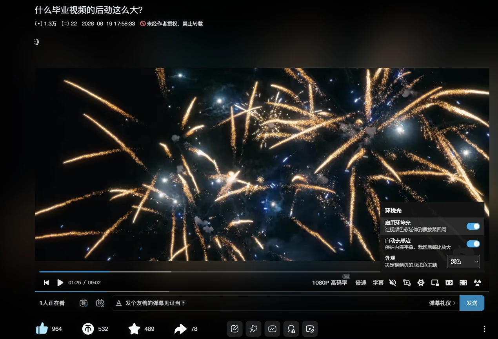

[简体中文](README.md) · **English**

# Bilibili Ambilight

Extend the colors of a Bilibili video beyond the player. Ambient light follows the picture as it changes, blending the header, danmaku controls and sidebar into the background.

[Download the extension](https://github.com/DrivingGodJ/bilibili-ambilight/releases/latest) · [Install the userscript](https://raw.githubusercontent.com/DrivingGodJ/bilibili-ambilight/userscript/bilibili-ambilight.user.js) · [User guide](docs/GUIDE.en.md)

## In the player

Click the ambient light icon next to the player gear to toggle ambient light and automatic cropping or change the appearance.
The screenshot features Roman De Giuli’s fluid art demo [Magic Fluids on Bilibili](https://www.bilibili.com/video/BV1sB4y1d7Ut/?t=92).

## Playback features

- **Dynamic ambient light** · Video colors follow the picture and the size of the player. Local shadows and glows keep text and small icons readable.
- **Automatic black-bar removal** · Detect horizontal or vertical bars and scale proportionally to keep the full picture visible. Burned-in subtitles that can be separated from a black bar are overlaid with a black outline.
- **Light and dark appearance** · Follow the system by default, or select light or dark. Press `G` to toggle ambient light and `B` to toggle automatic cropping.

## Get started

- **Chrome / Edge** · Download and extract `-chrome.zip` from Releases. Enable Developer mode on the extensions page, then load the extracted folder.
- **Firefox** · Download `-firefox.zip` from Releases and temporarily load it from Firefox's debugging page.
- **Userscript** · Install Tampermonkey or Violentmonkey, open the userscript link above, then reload a Bilibili video page.

See the [user guide](docs/GUIDE.en.md) for installation, shortcuts and builds. The interface supports Simplified Chinese, Traditional Chinese, English, Japanese and Korean.

## Documentation and feedback

- [Archived development reference (Traditional Chinese)](docs/readme-reference.zh-TW.md)
- [Privacy policy](PRIVACY-POLICY.md)
- [Report an issue](https://github.com/DrivingGodJ/bilibili-ambilight/issues)

A community project based on [iceorange-dev's Bilibili port](https://github.com/iceorange-dev/bilibili-ambilight) and [Wessel Kroos's original YouTube extension](https://github.com/WesselKroos/youtube-ambilight), released under the [MIT License](LICENSE).
