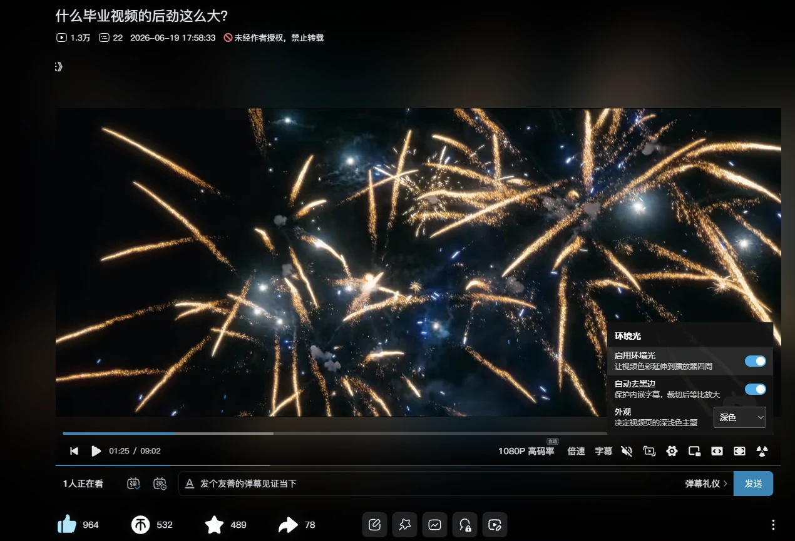

**简体中文** · [English](README.en.md)

# Bilibili 环境光

把 B 站视频的色彩延伸到播放器周围。画面一变，环境光也跟着变，导航栏、弹幕栏和侧栏自然融入背景。

[下载浏览器扩展](https://github.com/DrivingGodJ/bilibili-ambilight/releases/latest) · [安装用户脚本](https://raw.githubusercontent.com/DrivingGodJ/bilibili-ambilight/userscript/bilibili-ambilight.user.js) · [使用指南](docs/GUIDE.zh-CN.md)

## 界面实拍

点击播放设置齿轮左侧的环境光图标，就能开关环境光、自动去黑边，或选择界面外观。
截图取自[《什么毕业视频的后劲这么大？》](https://www.bilibili.com/video/BV139jB6BELL/)。

## 播放体验

- **动态环境光** · 从视频取色，随画面和播放器大小变化。文字和小图标用局部阴影与外发光保持清晰。
- **自动去黑边** · 识别上下或左右黑边，按比例缩放并保留完整正片。能从黑边分离的烧录字幕会加黑色描边后叠回。
- **深浅色外观** · 默认跟随系统，也可手动选择浅色或深色。用 `G` 开关环境光，`B` 开关自动去黑边。

## 开始体验

- **Chrome / Edge** · 从 Release 下载并解压 `-chrome.zip`，在扩展管理页开启开发人员模式，再加载解压后的文件夹。
- **Firefox** · 从 Release 下载 `-firefox.zip`，通过 Firefox 的调试页面临时加载。
- **用户脚本** · 安装 Tampermonkey 或 Violentmonkey 后，打开上方的用户脚本链接，再刷新 B 站视频页。

安装步骤、快捷键与构建方式见[使用指南](docs/GUIDE.zh-CN.md)。界面支持简体中文、繁体中文、英语、日语和韩语。

## 文档与反馈

- [历史开发参考（繁体中文）](docs/readme-reference.zh-TW.md)
- [隐私政策](PRIVACY-POLICY.md)
- [问题反馈](https://github.com/DrivingGodJ/bilibili-ambilight/issues)

本项目由社区维护，基于 [iceorange-dev 的 Bilibili 移植版](https://github.com/iceorange-dev/bilibili-ambilight)和 [Wessel Kroos 的 YouTube 原版](https://github.com/WesselKroos/youtube-ambilight)，采用 [MIT 许可](LICENSE)。
